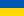

# C++ University Labs

**English** |  [Українська](README_UK.md)

[](https://github.com/Eduard-stack245/university-labs-cpp/actions/workflows/build.yml)
[](LICENSE)


My C++ labs from university, written in Visual Studio and similar IDEs.
Each lab is a separate project in `projects/` that builds on its own, so you
can pick any of them and run it.

## Quick start
```
git clone https://github.com/Eduard-stack245/university-labs-cpp.git
cd university-labs-cpp/projects/random-class
cmake -S . -B build
cmake --build build
```
Visual Studio users: `File -> Open -> Folder...` and pick a project folder.
Full instructions for every IDE and the terminal: [docs/BUILDING.md](docs/BUILDING.md).

## Projects

All projects use CMake and are set up to build on Windows, Linux and macOS; GitHub Actions checks this after every push (notes on the code: [docs/NOTES.md](docs/NOTES.md)).

| Project | What it is | Programs | Original names |
|---|---|---|---|
| [random-class](projects/random-class) | `Random` class: generator for all numeric types, arrays, vectors, seeding | 1 | Class_Random |
| [random-toolkit](projects/random-toolkit) | Lab generators as std-compatible engines, chi-square tester and `BasicRandom<Engine>` (merging random-class and asd-random-generators) | 3 | based on ASD_3Lab, ASD_4Lab |
| [records-database](projects/records-database) | One generic table of records (typed columns, CSV, UTF-8 search, sort, statistics) with a menu program; replaces four near-identical labs | 2 | based on Lb2_6_x, Lb2_8_2and3, Lb2_9_1, Dictionary, Lb2_10_1 |
| [textstat](projects/textstat) | Command-line text statistics (UTF-8: Cyrillic works): words, letter and word frequency, odd-length words, text in parentheses | 2 | based on Lb2_5_1, Lb2_5_2, Lb2_8_1 |
| [vector-class](projects/vector-class) | `Vector<T>`: templated dynamic array (rule of five, iterators, exception safety) with leak-detecting tests; successor of dynamic-array-class | 2 | based on 2-Lb_1_1-Dinamic_arr |
| [graph-algorithms](projects/graph-algorithms) | Prim and Dijkstra as a `Graph` class loaded from a file, `SparseGraph` (adjacency lists, priority queue, Kruskal) for big graphs, tests against Kruskal and Floyd-Warshall | 3 | based on ASD_1Lab, ASD_2Lab |
| [sorting-algorithms](projects/sorting-algorithms) | Header-only library: 8 sorting algorithms + array statistics; demo, self-checking tests and benchmark | 3 | SortProg (algorithms part) |
| [lab05-branching](projects/lab05-branching) | Lab 5 - branching (if / else) - First-semester C-style exercises: conditions, piecewise functions, the quadratic equation | 8 | Lb5_2 ... Lb5_9 |
| [lab06-loops](projects/lab06-loops) | Lab 6 - loops and series - for / while / do-while exercises: function tables, Taylor series, "what does this loop print" puzzles | 15 | Lb6_1 ... Lb6_15 |
| [lab07-arrays-and-lists](projects/lab07-arrays-and-lists) | Labs 7-8 - arrays, matrices, std::list - Splitting arrays by sign, quick sort, matrices, sorting a std::list | 5 | Lb7_1, Lb7_2, Lb7,8_3, Lb7-8,1(2), Lb7-8,2(2) |
| [lab09-10-sorting](projects/lab09-10-sorting) | Labs 9-10 - sorting and searching - Selection sort, quick sort, bubble sort, binary search | 2 | Lb9-10,1 / 2 |
| [lab11-12-modules](projects/lab11-12-modules) | Labs 11-12 - splitting a program into modules - A header + source module (`My_Lb`) with two tasks, used from `main` | 1 | Lb11_12 + My_Lb |
| [lab13-recursion](projects/lab13-recursion) | Lab 13 - recursion - Recursive functions: fraction series, Fibonacci numbers, number bases | 3 | Lb13_1, Lb13_3, Lb13_Add |
| [utility-payments](projects/utility-payments) | Utility payments calculator - Menu-driven calculator for utility bills (rent, electricity, gas, hot/cold water, heating) | 1 | lab5 / Lb 5_1 |
| [numbers-and-functions](projects/numbers-and-functions) | Numbers, functions and series - Second-series exercises: primes, function tables, Taylor series | 4 | Lb2_1_1 ... Lb2_1_3, ConsoleApplication4 |
| [arrays-and-matrices](projects/arrays-and-matrices) | Arrays and matrices - Second-series exercises with arrays and matrices | 5 | Lb2_2_1, Lb2-3_1, Lb2_4_1, Lb2_7_1, ConsoleApplication3 |
| [text-analysis](projects/text-analysis) | Text analysis - Strings: word counts, letter frequencies, text inside parentheses, reading a file and writing a log | 3 | Lb2_5_1, Lb2_5_2, Lb2_8_1 |
| [struct-tables](projects/struct-tables) | Tables of records (struct + vector) - Entering records into a `std::vector`, searching by field, printing a table | 2 | Lb2_6_1, Lb2_6_2 |
| [file-tables](projects/file-tables) | Menu programs with files - The record tables again, but stored in text files: add, show, search, log | 2 | Lb2_8_2and3, Lb2_9_1 |
| [dictionary](projects/dictionary) | Dictionary search - A small dictionary: search a word in `dict.txt` (format `word \| description`) | 1 | Dictionary |
| [dynamic-array-class](projects/dynamic-array-class) | Dynamic array class - A class that wraps a dynamically allocated array: input, output, sum | 1 | 2-Lb_1_1-Dinamic_arr |
| [binary-trees](projects/binary-trees) | Binary trees - Binary search trees: printing a tree sideways, and a student database stored in a tree | 2 | ConsoleApplication6, Lb2_10_1 |
| [asd-graph-algorithms](projects/asd-graph-algorithms) | ASD labs 1-2 - graph algorithms - Algorithms and data structures (ASD): minimum spanning tree and shortest path on a 6-vertex weighted graph | 2 | ASD_1Lab, ASD_2Lab |
| [asd-random-generators](projects/asd-random-generators) | ASD labs 3-4 - pseudo-random generators - Algorithms and data structures (ASD): four pseudo-random number generators and a chi-square test of their quality | 2 | ASD_3Lab, ASD_4Lab |


Plans and ideas for the next steps: [docs/ROADMAP.md](docs/ROADMAP.md).

## Repository layout
```
projects/        one folder per topic, each with its own CMakeLists.txt, README and sample inputs
common/          lab_compat.h - small portability layer (pause, clear screen, UTF-8 console)
cmake/           add_lab() helper used by every project
legacy-windows/  Windows-only projects (WinAPI, Windows Forms) with their .sln files
docs/            build instructions, notes on the code, roadmap
.github/         automatic build check on Windows, Linux, macOS
```

## Requirements
CMake 3.10+ and a C++ compiler. Each project's README lists the C++ standard
it needs. Targeted compilers: MSVC 2019+, GCC and Clang.
Every push is built on Windows, Linux and macOS by GitHub Actions
(see the *Actions* tab).

Adding a lab: [docs/ADDING_A_PROJECT.md](docs/ADDING_A_PROJECT.md). Contributing: [CONTRIBUTING.md](CONTRIBUTING.md).

## Author
[Babii Eduard](https://github.com/Eduard-stack245)

## License
MIT - see [LICENSE](LICENSE) (an unofficial Ukrainian translation: [docs/LICENSE.uk.md](docs/LICENSE.uk.md)).
