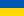

# C++ University Labs

[English](README.md) |  **Українська**

[](https://github.com/Eduard-stack245/university-labs-cpp/actions/workflows/build.yml)
[](LICENSE)


Мої університетські лабораторні на C++, написані у Visual Studio та подібних IDE.
Кожна лабораторна - окремий проєкт у `projects/`, який збирається сам по собі, тож можна вибрати будь-який і запустити.

## Швидкий старт
```
git clone https://github.com/Eduard-stack245/university-labs-cpp.git
cd university-labs-cpp/projects/random-class
cmake -S . -B build
cmake --build build
```
Користувачі Visual Studio: `File -> Open -> Folder...` і виберіть папку проєкту.
Повні інструкції для кожної IDE та термінала: [docs/BUILDING.uk.md](docs/BUILDING.uk.md).

## Проєкти

Усі проєкти використовують CMake і налаштовані на збірку в Windows, Linux і macOS; GitHub Actions перевіряє це після кожного push (примітки до коду: [docs/NOTES.uk.md](docs/NOTES.uk.md)).

| Проєкт | Що це | Програм | Оригінальні назви |
|---|---|---|---|
| [random-class](projects/random-class) | Клас `Random`: генератор для всіх числових типів, масиви, вектори, seed | 1 | Class_Random |
| [random-toolkit](projects/random-toolkit) | Генератори з лабораторних як рушії, сумісні зі std, тестер хі-квадрат і `BasicRandom<Engine>` (об'єднання random-class і asd-random-generators) | 3 | на основі ASD_3Lab, ASD_4Lab |
| [records-database](projects/records-database) | Універсальна таблиця записів (типізовані стовпці, CSV, пошук у UTF-8, сортування, статистика) з меню; замінює чотири майже однакові лабораторні | 2 | на основі Lb2_6_x, Lb2_8_2and3, Lb2_9_1, Dictionary, Lb2_10_1 |
| [textstat](projects/textstat) | Консольна статистика тексту (UTF-8, кирилиця працює): слова, частоти літер і слів, слова непарної довжини, текст у дужках | 2 | на основі Lb2_5_1, Lb2_5_2, Lb2_8_1 |
| [vector-class](projects/vector-class) | `Vector<T>`: шаблонний динамічний масив (правило п'яти, ітератори, безпека щодо винятків) з тестами, що виявляють витоки; наступник dynamic-array-class | 2 | на основі 2-Lb_1_1-Dinamic_arr |
| [graph-algorithms](projects/graph-algorithms) | Прим і Дейкстра як клас `Graph` із файлу, `SparseGraph` (списки суміжності, черга з пріоритетом, Краскал) для великих графів, тести проти Краскала і Флойда-Воршелла | 3 | на основі ASD_1Lab, ASD_2Lab |
| [sorting-algorithms](projects/sorting-algorithms) | Бібліотека з одного заголовка: 8 алгоритмів сортування + статистика масивів; демо, тести, що самі перевіряють результат, і бенчмарк | 3 | SortProg (algorithms part) |
| [lab05-branching](projects/lab05-branching) | Лабораторна 5 - розгалуження (if / else) - Вправи першого семестру в стилі C: умови, кускові функції, квадратне рівняння | 8 | Lb5_2 ... Lb5_9 |
| [lab06-loops](projects/lab06-loops) | Лабораторна 6 - цикли та ряди - Вправи на for / while / do-while: таблиці функцій, ряди Тейлора, головоломки «що надрукує цей цикл» | 15 | Lb6_1 ... Lb6_15 |
| [lab07-arrays-and-lists](projects/lab07-arrays-and-lists) | Лабораторні 7-8 - масиви, матриці, std::list - Розділення масивів за знаком, швидке сортування, матриці, сортування std::list | 5 | Lb7_1, Lb7_2, Lb7,8_3, Lb7-8,1(2), Lb7-8,2(2) |
| [lab09-10-sorting](projects/lab09-10-sorting) | Лабораторні 9-10 - сортування та пошук - Сортування вибором, швидке сортування, сортування бульбашкою, бінарний пошук | 2 | Lb9-10,1 / 2 |
| [lab11-12-modules](projects/lab11-12-modules) | Лабораторні 11-12 - поділ програми на модулі - Модуль із заголовка та реалізації (`My_Lb`) з двома завданнями, що використовується з `main` | 1 | Lb11_12 + My_Lb |
| [lab13-recursion](projects/lab13-recursion) | Лабораторна 13 - рекурсія - Рекурсивні функції: ряд дробів, числа Фібоначчі, системи числення | 3 | Lb13_1, Lb13_3, Lb13_Add |
| [utility-payments](projects/utility-payments) | Калькулятор комунальних платежів - Меню для розрахунку комунальних платежів (квартплата, електроенергія, газ, гаряча/холодна вода, опалення). Тарифи беруться з `config.txt` або зі значень за замовчуванням | 1 | lab5 / Lb 5_1 |
| [numbers-and-functions](projects/numbers-and-functions) | Числа, функції та ряди - Вправи другої серії: прості числа, таблиці функцій, ряди Тейлора | 4 | Lb2_1_1 ... Lb2_1_3, ConsoleApplication4 |
| [arrays-and-matrices](projects/arrays-and-matrices) | Масиви та матриці - Вправи другої серії з масивами та матрицями | 5 | Lb2_2_1, Lb2-3_1, Lb2_4_1, Lb2_7_1, ConsoleApplication3 |
| [text-analysis](projects/text-analysis) | Аналіз тексту - Рядки: підрахунок слів, частоти літер, текст у дужках, читання файлу та запис журналу | 3 | Lb2_5_1, Lb2_5_2, Lb2_8_1 |
| [struct-tables](projects/struct-tables) | Таблиці записів (struct + vector) - Введення записів у `std::vector`, пошук за полем, друк таблиці | 2 | Lb2_6_1, Lb2_6_2 |
| [file-tables](projects/file-tables) | Меню-програми з файлами - Ті самі таблиці записів, але у текстових файлах: додати, показати, шукати, журнал | 2 | Lb2_8_2and3, Lb2_9_1 |
| [dictionary](projects/dictionary) | Пошук у словнику - Невеликий словник: пошук слова в `dict.txt` (формат `слово \| опис`). Розділено на модулі: `File` (доступ до даних) і `View` (виведення) | 1 | Dictionary |
| [dynamic-array-class](projects/dynamic-array-class) | Клас динамічного масиву - Клас-обгортка над динамічно виділеним масивом: введення, виведення, сума | 1 | 2-Lb_1_1-Dinamic_arr |
| [binary-trees](projects/binary-trees) | Бінарні дерева - Бінарні дерева пошуку: друк дерева боком і база студентів, що зберігається в дереві | 2 | ConsoleApplication6, Lb2_10_1 |
| [asd-graph-algorithms](projects/asd-graph-algorithms) | ASD, лабораторні 1-2 - графові алгоритми - Алгоритми та структури даних (ASD): мінімальне остовне дерево та найкоротший шлях у зваженому графі з 6 вершин | 2 | ASD_1Lab, ASD_2Lab |
| [asd-random-generators](projects/asd-random-generators) | ASD, лабораторні 3-4 - генератори псевдовипадкових чисел - Алгоритми та структури даних (ASD): чотири генератори псевдовипадкових чисел і тест хі-квадрат для оцінки їхньої якості | 2 | ASD_3Lab, ASD_4Lab |


Плани та ідеї на наступні кроки: [docs/ROADMAP.uk.md](docs/ROADMAP.uk.md).

## Структура репозиторію
```
projects/        одна папка на тему, у кожній свій CMakeLists.txt, README і приклади вводу
common/          lab_compat.h - невеликий шар сумісності (пауза, очищення екрана, консоль UTF-8)
cmake/           допоміжна функція add_lab(), якою користується кожен проєкт
legacy-windows/  проєкти лише для Windows (WinAPI, Windows Forms) з файлами .sln
docs/            інструкції зі збірки, примітки до коду, плани
.github/         автоматична перевірка збірки на Windows, Linux, macOS
```

## Вимоги
CMake 3.10+ і компілятор C++. У README кожного проєкту вказано потрібний стандарт C++. Цільові компілятори: MSVC 2019+, GCC і Clang.
Кожен push збирається на Windows, Linux і macOS через GitHub Actions (дивіться вкладку *Actions*).

Додавання лабораторної: [docs/ADDING_A_PROJECT.uk.md](docs/ADDING_A_PROJECT.uk.md). Участь у проєкті: [CONTRIBUTING.md](CONTRIBUTING.md).

## Автор
[Babii Eduard](https://github.com/Eduard-stack245)

## Ліцензія
MIT - див. [LICENSE](LICENSE) (неофіційний український переклад: [docs/LICENSE.uk.md](docs/LICENSE.uk.md)).
